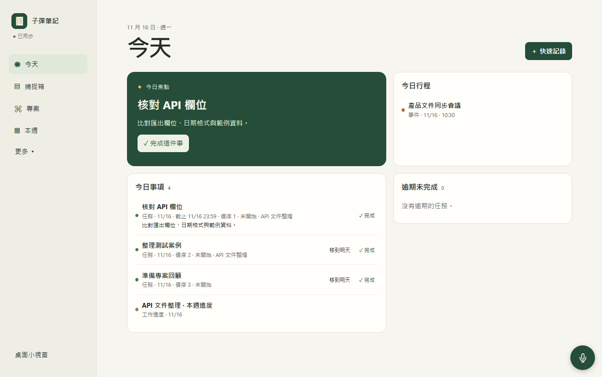
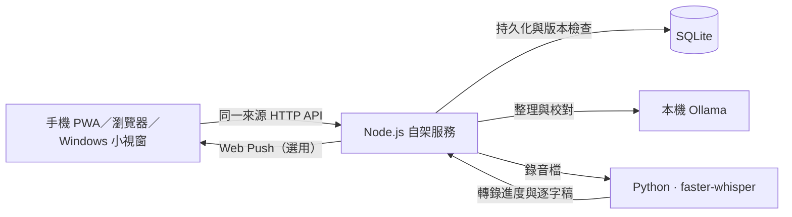

# 子彈筆記 · Personal Bullet Journal

一套可自行架設的個人筆記與任務管理 PWA。把突然想到的事情先放進捕捉箱，再安排成今日任務、專案子任務或未來計畫。手機、電腦與 Windows 桌面小視窗連到同一個服務，共用行程與筆記。會議錄音可由本地 Whisper 轉錄，再交給 Ollama 整理。



## 功能

| 功能 | 使用方式 |
| --- | --- |
| 快速記錄 | 用文字、瀏覽器聽寫或批次貼上新增事項。先預覽並編輯分類、標題、日期和內容，再儲存。 |
| 任務與專案 | 分開設定開始日期和截止時間。使用今日焦點、逾期清單、專案子任務與橫向時間軸追蹤進度。 |
| 日曆與日常 | 查看週、月及全年行程，設定週目標、固定日常及生日提醒，查看最近 8 週日常完成率。 |
| 會議紀錄 | 匯入錄音、使用麥克風，或在支援的桌面瀏覽器擷取會議分頁音訊。查看轉錄進度和 CPU／GPU，依上課、會議或工作進度整理。 |
| 筆記與健康 | 搜尋日誌及筆記、檢查疑似語音誤聽，手動記錄健康量測並查看趨勢。有相容 Ollama 視覺模型時可辨識體脂機截圖。 |
| Windows 小視窗 | 從桌面快速查看今天、待辦、本週行程與待整理的捕捉。 |

## 執行方式

需要 **Node.js 24 以上**及瀏覽器。基本筆記、任務、日曆和日常可直接使用。

```powershell
git clone https://github.com/yantingque/bullet-journal.git
cd bullet-journal
npm ci
.\Start-Journal.cmd
```

打開 [http://localhost:8776](http://localhost:8776)，輸入啟動視窗顯示的配對碼。Windows 上也可雙擊 `Open-Desktop.cmd` 開啟小視窗。其他平台可在啟動前設定 `JOURNAL_SHOW_KEY=1`，再執行 `npm start`。

| 選用功能 | 所需環境 |
| --- | --- |
| AI 分類、修飾與摘要 | 安裝 Ollama 與文字模型，在 `data/ai-model.txt` 填入模型名稱並重啟。也可設定 `JOURNAL_AI_MODEL`。 |
| 錄音轉逐字稿 | Python 3.11、faster-whisper 及本地語音模型。可使用 CPU，有相容 NVIDIA 驅動和函式庫時也可選 GPU。 |
| 手機安裝與推播 | 手機可連到服務主機的 HTTPS 網址，並在 App 裡允許推播。 |

完整設定請看[使用手冊](docs/user-guide.md)。目前採用單人自架模式，服務運行時裝置才能同步。PWA 提供安裝介面，資料同步依賴服務端。

## 架構



- **前端**使用原生 JavaScript、CSS、Web App Manifest 與 Service Worker。任務排程及日常統計規則放在共享的 `public/model.mjs`。
- **服務端**使用 Node.js HTTP 和內建 SQLite。配對後以 HTTP-only cookie 驗證，資料更新比較版本，過期版本回傳 HTTP 409。批次新增任務使用交易提交。
- **錄音轉錄**由 `transcribe-meeting.py` 執行。自動模式對 30 秒內的音訊用 CPU，較長音訊優先嘗試 GPU。服務逐行送出讀取、載入與辨識進度，畫面可取消轉錄並保留錄音。
- **AI 整理**把文字交給本機 Ollama。長逐字稿先分段整理再彙整。摘要和逐字稿都可編輯，確認後才存入 SQLite。瀏覽器聽寫可能使用瀏覽器供應商的辨識服務。

## 可重現驗證

```sh
npm test
```

測試會在系統暫存目錄建立一套獨立資料庫，以兩個登入用戶端檢查配對、同步、版本衝突、日常、提醒、垃圾桶、服務重啟與 PWA 資源。基本測試無需 AI 模型。語音與會議功能另曾以 Chrome、合成錄音和本地模型驗證，詳細範圍見[面試展示指南](docs/interview-demo.md)。

## 程式位置

| 路徑 | 負責內容 |
| --- | --- |
| `server.mjs` | HTTP API、登入、持久化、提醒與本地 AI 調用 |
| `public/app.mjs`、`public/model.mjs` | 主介面與共享業務規則 |
| `public/meeting.mjs`、`transcribe-meeting.py` | 錄音、進度、轉錄裝置與紀錄整理 |
| `desktop.mjs`、`Open-Desktop.cmd` | Windows 桌面小視窗 |
| `tests/journal.test.mjs` | 本機 API 整合測試 |

[操作手冊](docs/user-guide.md) · [面試展示與技術問答](docs/interview-demo.md)
