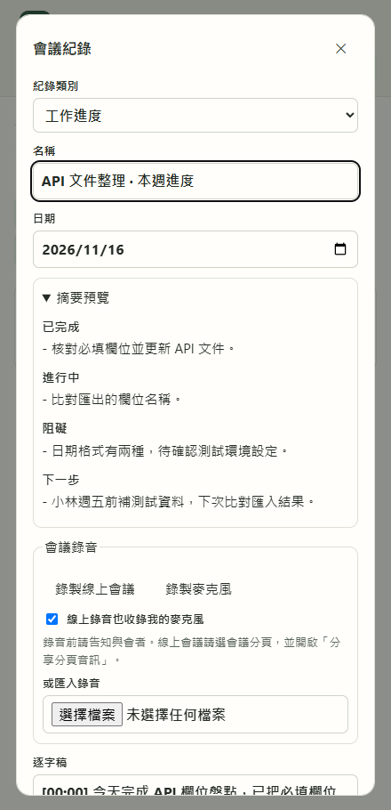

# 子彈筆記面試展示

## 30 秒介紹

這個專案把子彈筆記的快速捕捉做成手機與桌面都能使用的自架 PWA。我可以先記下待辦，晚點再安排日期和專案。錄音則可以在自己電腦轉成逐字稿，依照會議、上課或工作進度產生不同格式的摘要。展示重點是資料如何跨裝置同步，以及本地 AI 如何在一筆真實的工作流程裡回報進度、允許修正並保存結果。

## 五分鐘現場展示

1. **快速記錄與整理。** 快速新增「核對 API 欄位」，切到捕捉箱改成任務，分別填開始和截止日期，將任務放入專案。回到今天查看今日焦點或逾期狀態。
2. **跨裝置同步。** 以另一個瀏覽器工作階段連到同一個服務，配對後查看剛才新增的任務。說明伺服器是共用資料來源，舊版本寫回時會被拒絕。
3. **本地 AI 工作流。** 在「更多 → 會議紀錄」選「會議」，匯入一段自製短音檔。轉錄時指出進度、CPU／GPU 與取消按鈕，再按「本地 AI 整理」。更改一處辨識文字並核對責任與期限後儲存。
4. **說明取捨。** 打開月曆或桌面小視窗，說明哪些資訊適合立即查看、哪些適合留在原始紀錄。若展示現場沒有模型，貼上準備好的逐字稿也能展示分類、編輯、摘要預覽及同步。



### 可貼入的示範逐字稿

```text
[00:00] 今天完成 API 欄位盤點，已把必填欄位補到文件。
[00:10] 正在比對匯出的欄位名稱。兩個日期欄位格式不同，要先和測試環境核對。
[00:22] 小林週五前會補上一組測試資料，下次檢查匯入結果。
```

建議用「工作進度」整理這一段，可展示已完成、進行中、阻礙與下一步。若用「會議」，可對照模型會如何找摘要、決議、待辦和待確認事項。

## 可討論的技術取捨

| 面試問題 | 可以說明的實作 |
| --- | --- |
| 兩個裝置同時編輯會怎樣？ | 寫入時比對資料版本。舊版本收到 409，前端提示重新開啟，避免後存的舊資料覆蓋新內容。 |
| 為什麼轉錄和整理用兩個模型？ | Whisper 讀取音訊並產生帶時間戳的逐字稿。Ollama 依紀錄類型整理文字。拆開處理後，可先校對專有名詞再重做摘要。 |
| 進度百分比代表什麼？ | 使用最近辨識段落的結束時間除以音訊長度。讀音檔及載入模型時顯示階段，結果返回前最高顯示 99%。這是音訊處理位置，耗時會受模型、靜音比例及硬體影響。 |
| GPU 如何選？ | 30 秒內預設 CPU，較長優先候選 GPU，也支援手動指定。45 秒合成音檔在開發機 RTX 5070 Ti 上約 13 秒、CPU 約 30 秒，包含啟動與載入，屬於單機單次觀察。 |
| 哪些設定適合公開分享？ | 公開的是程式、文件和合成範例。自架服務的資料庫、配對碼、錄音及模型留在自己的環境。 |

## 測試與展示範圍

- `npm test` 可在乾淨環境驗證 HTTP API、日期與提醒規則、資料一致性和重啟後的持久化。
- 瀏覽器測試曾用手機寬度與桌面 Chrome 驗證錄音、取消、GPU 轉錄進度、AI 整理、類別篩選、編輯與復原。圖片使用獨立資料庫和合成內容。
- 真實手機推播、背景錄音與分頁音訊能力取決於作業系統、瀏覽器、HTTPS 和權限，正式展示前以現場裝置確認。
